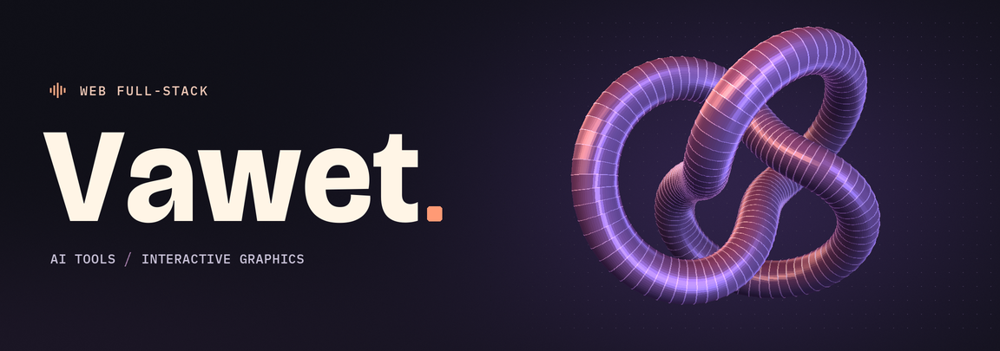

<picture>
  <source media="(prefers-reduced-motion: no-preference)" srcset="./assets/vawet-orbit.gif">
  
</picture>

你好，我是 Vawet。我做 Web 全栈开发，最近在写 AI 学习工具。也喜欢研究前端的手感，比如画布上多了几千个节点，怎样才能让拖拽依然流畅。

## 精选项目

🎞️ **[VideoParse](https://github.com/Vawet/VideoParse) · 视频学习工具** 
把一堂课整理成带截图的讲义和思维导图。遇到没听懂的地方，可以直接提问，沿时间戳回到原片。 
`React` · `Flask` · `FFmpeg`

🔎 **[知数 · NL2SQL](https://github.com/Vawet/NL2SQL) · 教学数据分析** 
问「这学期各班的数学平均分是多少？」，先看清统计口径和生成的 SQL，确认后再查结果。 
`Vue 3` · `Python` · `MySQL`

🕸️ **[节点画布实验](https://github.com/Vawet/xyflow-react-flow-) · 交互与渲染** 
用 React Flow 和 PixiJS 画出同一类节点图，边拖拽、边缩放，观察 DOM 和 GPU 渲染的帧率变化。 
`TypeScript` · `React Flow` · `PixiJS`
